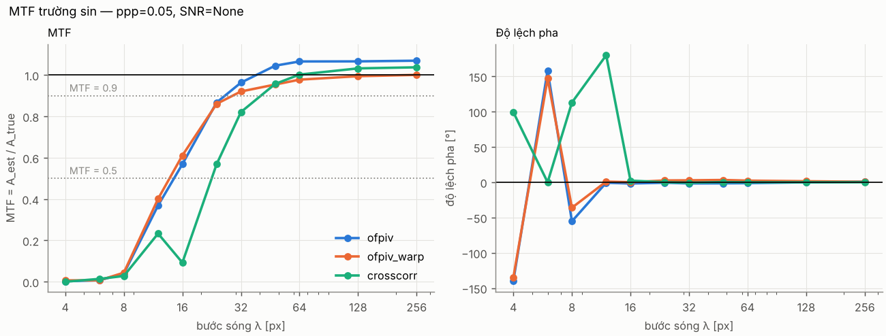
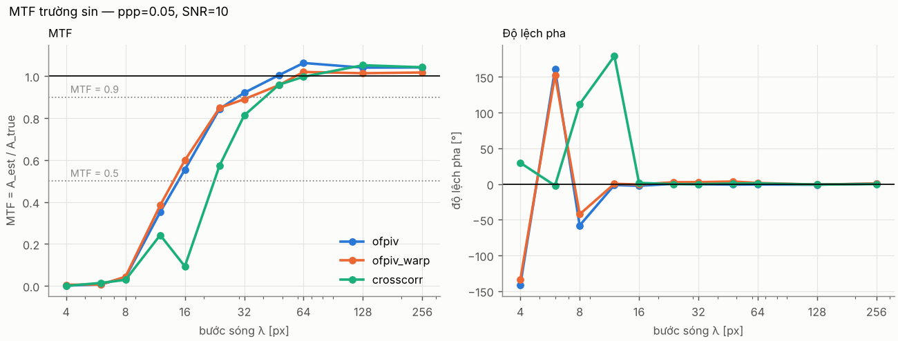
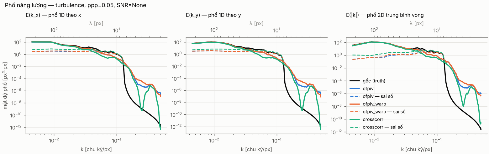
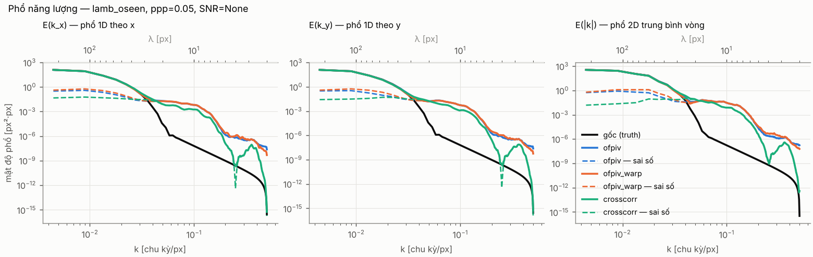
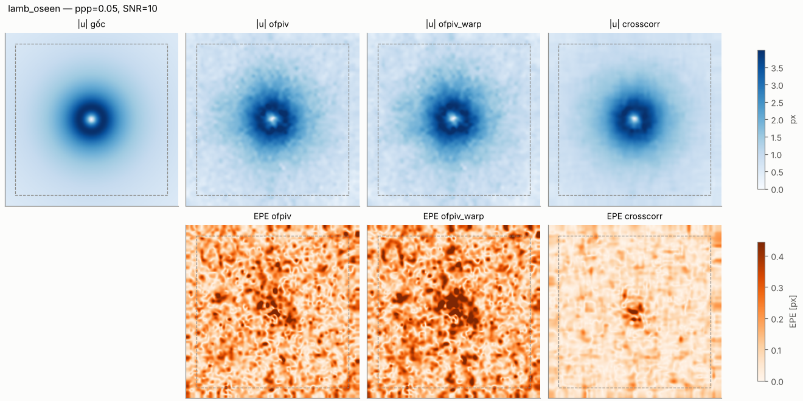
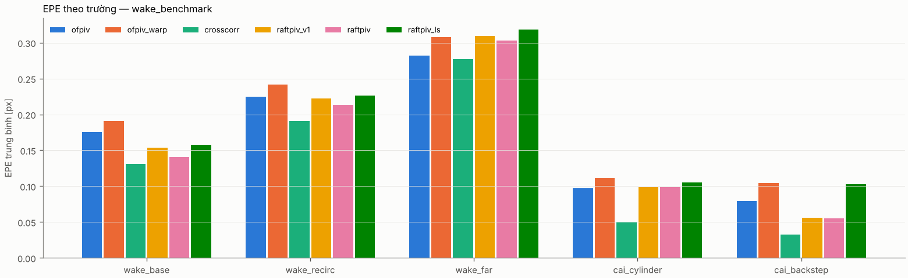
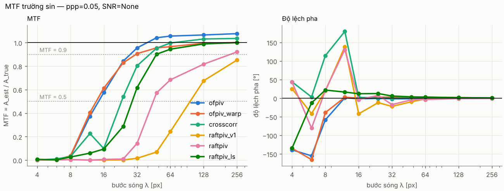
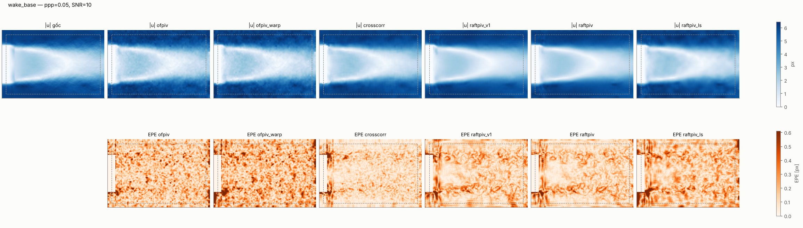
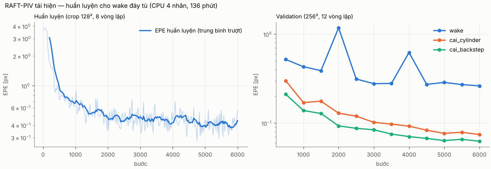

# piv-dense-benchmark

Benchmark các phương pháp PIV dày đặc (1 vector/pixel) so với trường gốc (trường tổng hợp hoặc DNS):
sai số điểm (EPE, RMSE), phổ năng lượng của trường và của sai số, MTF theo bước sóng, và sai số ở
vùng gradient mạnh.

## Cấu trúc

```
src/pivbench/
  synth/     ảnh hạt tổng hợp (particles.py) + trường test (fields.py)
  data/      đọc cặp ảnh PIV Challenge (tif/bmp/png) và trường gốc (npz/h5/mat/dat)
  methods/   ofpiv, crosscorr, raftpiv — estimate(img1, img2, **params) -> (u, v) cỡ ảnh
  metrics/   errors.py, spectra.py, mtf.py, gradient.py
  plotting.py
scripts/     run_benchmark.py, train_raftpiv.py, infer_raftpiv.py, matlab_bridge.py, download_data.md
matlab/      giao diện & hàm MATLAB (pivbench_gui, pivbench_estimate, …) — xem matlab/README_MATLAB.md
configs/     example_small.yaml (CPU, 256×256), full.yaml
tests/       pytest
results/     results/<tên_thí_nghiệm>/ (chỉ example_small được commit, không kèm npz)
checkpoints/ trọng số RAFT-PIV tái hiện (v1, v2) + nhật ký huấn luyện
docs/        RAFTPIV_WAKE.md — kiến trúc, dữ liệu, tham số cho wake đáy tù
third_party/ chỗ đặt mã nguồn + trọng số RAFT-PIV chính thức (không có sẵn)
```

Quy ước: `x` = cột, `y` = hàng (hướng xuống); `u` theo x, `v` theo y; đơn vị px / khoảng thời gian giữa 2 ảnh.

## Dùng từ MATLAB

Toàn bộ chức năng dùng được từ MATLAB — giao diện `pivbench_gui` (R2020b+) hoặc các hàm `pivbench_estimate`,
`pivbench_synth`, `pivbench_metrics`, `pivbench_spectra`, `pivbench_mtf`. Cài Python một lần bằng
`setup_windows.bat` / `setup_unix.sh`, rồi trong MATLAB: `cd matlab; pivbench_check; pivbench_gui`.
Chi tiết: **[matlab/README_MATLAB.md](matlab/README_MATLAB.md)**.

## Cài đặt

```bash
python3.11 -m venv .venv && source .venv/bin/activate
pip install -e ".[all]"        # numpy scipy scikit-image matplotlib h5py pyyaml torch openpiv pytest
pytest
```

## Chạy benchmark

```bash
python scripts/run_benchmark.py configs/example_small.yaml
```

YAML mô tả lưới `phương pháp × trường × ppp × SNR × seed`; mỗi phương pháp có `params` cố định và
`sweep` (tích Descartes các tham số, ví dụ `sweep: {lambda_LS: [200, 2000, 20000]}`). Trường `sine`
với danh sách `wavelengths` sinh một ca cho mỗi λ để đo MTF. Đầu ra trong `results/<name>/`:
`summary.csv`, `mtf.csv`, `cutoffs.csv`, `spectra/*.npz`, `fields/*.npz`, `figures/*.png`,
`unavailable.txt` (phương pháp không chạy được và lý do).

## Thành phần

### Bộ sinh ảnh hạt (`pivbench.synth`)
- Hạt Gauss tích phân giải tích trên pixel (erf), đường kính e⁻² `d_p` (mặc định 2.5 px), mật độ `ppp`,
  cường độ đỉnh ~ U(`intensity_min`, 1).
- Nhiễu Poisson + Gauss theo `snr` = I_peak/σ_noise (`poisson_fraction` = tỉ lệ phương sai do Poisson tại đỉnh).
- Tấm laser Gauss dày `sheet_thickness`, dịch chuyển ngoài mặt phẳng `out_of_plane_w`/`out_of_plane_std`
  → hạt mờ/mất cặp (`meta["n_lost_pairs"]`).
- Ảnh 2 tạo bằng **dịch vị trí hạt** (không warp ảnh): vị trí gieo tại t = ½, tích phân RK4 lùi/tiến
  nửa bước; trường lưới được nội suy B-spline bậc 3. Hạt được gieo trên miền mở rộng để không có vùng trống ở biên.
- Trường: (a) `SineField` u = A·sin(2πx/λ) (tuỳ chọn thành phần/hướng); (b) `LambOseenField`
  (tham số `u_max`, `core_radius`); (c) `TurbulenceField` — hàm dòng có phổ E(k) ∝ k^-5/3, pha ngẫu nhiên,
  u = ∂ψ/∂y, v = −∂ψ/∂x bằng đạo hàm phổ ⇒ div = 0 tới sai số máy; (d) `load_dns_field` (npz/HDF5, cắt lát 3D,
  hệ số đổi đơn vị) và giao diện trống `DNSSource`/`JHTDBSource`/`PIVChallengeSource`.

### Phương pháp (`pivbench.methods`)
| tên | mô tả |
|---|---|
| `ofpiv` | Port Python của [OpenOpticalFlow_PIV](https://github.com/Tianshu-Liu/OpenOpticalFlow_PIV_v1) (Liu & Salazar, JORS 2021): chuẩn hoá cường độ, hiệu chỉnh độ sáng, lọc Gauss `fspecial(6, 0.62·6)`, Horn–Schunck (λ₁ = `lambda_HS`, 500 vòng) khởi tạo, Liu–Shen (λ₂ = `lambda_LS`, 60 vòng) tinh chỉnh, khởi tạo tương quan chéo tuỳ chọn (`init='crosscorr'`), kim tự tháp `n_levels`, lặp `n_iter`. |
| `crosscorr` | PIV FFT nhiều lượt, biến dạng cửa sổ đối xứng (nội suy bậc 3), đỉnh Gauss 3 điểm, normalized median test; lưới vector nội suy bậc 3 về từng pixel. Tự cài đặt (gói `openpiv` 0.26 cài được nhưng không dùng để giữ kiểm soát toàn bộ pipeline). |
| `raftpiv` | RAFT-PIV **tái hiện** (huấn luyện cho wake đáy tù, trọng số kèm repo) hoặc bản chính thức nếu có — xem mục RAFT-PIV. |

**Khác biệt của `ofpiv` so với mã MATLAB gốc** (chi tiết trong docstring `methods/ofpiv.py`):
1. Ảnh đầu vào được đưa về thang 0–255 bằng *cùng* min/max cho 2 ảnh (bản gốc giả định uint8; λ phụ thuộc thang cường độ).
2. `shift_image_fun_refine_1` không ép `uint8` ảnh đã dịch (tuỳ chọn `quantize_shift=True` để giống hệt).
3. Thêm kim tự tháp và lặp (bản gốc cố định 1 lượt, 1 mức `scale_im`); `n_levels=1, n_iter=1` = bản gốc.
4. Khởi tạo tương quan chéo dùng `crosscorr` của repo này (cùng cửa sổ [64 16 8], bước 50%) thay cho PIVsuite.
5. Vòng lặp Jacobi của Horn–Schunck và vòng gán pixel được vector hoá (cùng công thức, giữ cả ma trận đếm lân cận `cmtx` "lạ" của bản gốc: cạnh dùng 8 thay vì 5; `hs_exact_counts=True` để sửa).
6. Mở rộng tuỳ chọn `shift_method='warp'`: thay phép dịch nguyên + vận chuyển bậc 1 cho phần lẻ bằng nội suy B-spline bậc 3. Mặc định vẫn là `'original'`.

Hai quan sát khi kiểm tra port (đều là tính chất của bản gốc, đã đối chiếu bằng thí nghiệm):
- Stencil 2×2 của HS và data term của Liu–Shen đánh giá thấp dịch chuyển dưới pixel ≈ 6–8 % (ví dụ 0.5 px → 0.47 px) với hạt d_p = 2.5 px; lọc Gauss 6×6 làm giảm sai lệch này. Khi lặp với `shift_method='warp'`, phần dư → 0 và sai lệch biến mất (EPE 0.004 px ở dịch chuyển đều 0.5 px).
- `shift_image_fun_refine_1` dịch đúng phần nguyên (EPE 0.0045 px ở (2, −1) px) nhưng phần lẻ lớn để lại sai số: (2.3, −1.4) px → EPE 0.062 px, (2.5, −1.5) px → 0.088 px.

### Bộ đo (`pivbench.metrics`)
- `error_stats`: EPE trung bình/trung vị/p95/max, RMSE từng thành phần, bias, bỏ biên `border`.
- `spectra_report`: phổ 1D theo x và y (Welch, Hann, trung bình theo hàng/cột) và phổ 2D trung bình
  vòng, **luôn cho cả trường gốc, trường ước lượng và sai số (u_est − u_true)**.
- `mtf_from_sine`: khớp bình phương tối thiểu tại đúng λ → MTF = A_est/A_true và độ lệch pha;
  `cutoffs` → λ_c tại MTF = 0.9 và 0.5 (cấu hình `metrics.mtf_thresholds`). Pha không có ý nghĩa khi MTF ≈ 0 (λ ≤ 8 px).
- `strong_gradient_errors`: mặt nạ top `top_percent` % của |ω| hoặc ‖∇u‖ của trường gốc, EPE trong/ngoài.
- `vortex_peak_error`: đỉnh |ω| ước lượng (max trong bán kính 10 px — bị nhiễu đẩy lên) và
  `omega_center_rel_error` (trung bình ω trên đĩa 2 px tại đúng đỉnh gốc — ít thiên lệch hơn).

## Kết quả thí nghiệm nhỏ (`configs/example_small.yaml`)

Ảnh 256×256, d_p = 2.5 px, ppp = 0.05, SNR ∈ {không nhiễu, 10}, 1 seed, bỏ biên 16 px, CPU 4 nhân: 3 phút.
`ofpiv` = đúng quy trình `OpenOpticalFlow_PIV_Run.m` (λ₁ = 20, λ₂ = 2000, khởi tạo CC, 1 lượt);
`ofpiv_warp` = cùng tham số + `shift_method='warp'`, 3 lượt.

| trường | SNR | phương pháp | EPE [px] | EPE vùng top-10 % \|ω\| | EPE ngoài | ω tại tâm xoáy (sai số tương đối) | thời gian [s] |
|---|---|---|---|---|---|---|---|
| Lamb–Oseen (r_c = 16, u_max = 4) | ∞ | ofpiv | 0.070 | 0.197 | 0.056 | +9.5 % | 1.7 |
| | ∞ | ofpiv_warp | 0.048 | 0.250 | 0.026 | +5.3 % | 4.4 |
| | ∞ | crosscorr | **0.024** | **0.086** | **0.017** | +13.4 % | 0.4 |
| | 10 | ofpiv | 0.157 | 0.238 | 0.148 | +6.0 % | 1.8 |
| | 10 | ofpiv_warp | 0.184 | 0.310 | 0.170 | +1.6 % | 4.5 |
| | 10 | crosscorr | **0.073** | **0.119** | **0.068** | +13.5 % | 0.5 |
| Rối k^-5/3 (rms 2 px, λ_min 8 px) | ∞ | ofpiv | **0.616** | 0.695 | 0.607 | | 1.6 |
| | ∞ | ofpiv_warp | 0.619 | 0.702 | 0.610 | | 4.7 |
| | ∞ | crosscorr | 0.843 | 0.891 | 0.838 | | 0.5 |
| | 10 | ofpiv | **0.651** | 0.725 | 0.643 | | 1.6 |
| | 10 | crosscorr | 0.863 | 0.914 | 0.857 | | 0.6 |

Bước sóng cắt (trường sin u = 0.5·sin(2πx/λ)):

| phương pháp | SNR | λ_c(MTF = 0.9) [px] | λ_c(MTF = 0.5) [px] |
|---|---|---|---|
| ofpiv | ∞ | 26.5 | 14.5 |
| ofpiv_warp | ∞ | 29.0 | 13.7 |
| crosscorr (cửa sổ cuối 16 px) | ∞ | 40.5 | 22.6 |
| ofpiv | 10 | 29.6 | 14.8 |
| ofpiv_warp | 10 | 34.0 | 14.0 |
| crosscorr | 10 | 40.8 | 22.6 |

Nhận xét ngắn: phương pháp optical flow phân giải tốt hơn rõ rệt (λ_c(0.5) ≈ 14 px so với 23 px, sai số trên
trường rối thấp hơn ~27 %), nhưng nhạy nhiễu hơn và ở trường trơn (Lamb–Oseen) thì sai số cao hơn CC; `ofpiv`
gốc có MTF > 1 (≈ 1.06) ở λ lớn do sai lệch của bước dịch phần lẻ, biến thể `warp` cho MTF ≈ 1.00.
Đây là 1 seed — cần nhiều seed (`configs/full.yaml`) trước khi kết luận.







Trong hình phổ: đen = trường gốc, màu liền = ước lượng, màu đứt = sai số. Phổ trường rối gốc rơi
thẳng đứng tại k = 1/8 chu kỳ/px vì phổ bị cắt ở λ_min = 8 px.

## RAFT-PIV

### Bản chính thức (Lagemann et al. 2021): không có
Không tìm được repo mã nguồn/trọng số chính thức truy cập được (tìm kiếm web không ra; nature.com, zenodo.org
bị chặn từ môi trường build). `backend="official"` của `methods/raftpiv.py` vẫn sẵn sàng nếu bạn có bản gốc
(`third_party/RAFT-PIV` + `RAFTPIV_CKPT`).

### Bản tái hiện, huấn luyện cho wake sau mô hình trục đối xứng đáy tù (`backend="local"`, mặc định)
Mạng viết lại từ đầu theo kiến trúc RAFT/RAFT-PIV (`src/pivbench/methods/raft/`, 1.8 M tham số, đặc trưng /4,
tương quan toàn cặp 4 mức, ConvGRU, nâng mẫu lồi) — chi tiết, lý do chọn tham số và cách chỉnh cho thí nghiệm
của bạn: **[docs/RAFTPIV_WAKE.md](docs/RAFTPIV_WAKE.md)**. Trọng số đi kèm repo:

| checkpoint | huấn luyện (CPU 4 nhân) | dữ liệu |
|---|---|---|
| `checkpoints/raftpiv_wake/best.pt` (v1) | 6 000 bước, 136 phút | wake đáy tù tổng hợp (div₂D = 0) + trường tổng quát + Cai et al. cylinder/backstep |
| `checkpoints/raftpiv_wake_v2/best.pt` (**v2, mặc định**) | + 3 000 bước tinh chỉnh | wake theo **liên tục trục đối xứng** (div₂D = −v/r) + trường nén được + sin + Cai |

```bash
python scripts/infer_raftpiv.py anh_a.tif anh_b.tif -o out/ --compare     # ảnh của bạn → npz/.flo/.mat/.png
python scripts/train_raftpiv.py configs/raftpiv_wake_v2.yaml               # huấn luyện lại / tiếp
python scripts/run_benchmark.py configs/wake_benchmark.yaml && python scripts/summarize_results.py results/wake_benchmark
```

**Kết quả** (`results/wake_benchmark/summary.md`, ảnh 256×384, d_p = 2.5 px, ppp ∈ {0.02, 0.05}, SNR ∈ {∞, 10};
Cai: 8 cặp test/lớp, chỉ tính vùng có hạt). EPE trung bình [px]:

| trường | ofpiv | crosscorr | RAFT v1 | **RAFT v2** | RAFT v2 + Liu–Shen |
|---|---|---|---|---|---|
| wake sát đáy | 0.176 | **0.131** | 0.154 | 0.140 | 0.158 |
| wake vùng tuần hoàn | 0.225 | **0.191** | 0.222 | 0.213 | 0.226 |
| wake xa | 0.282 | **0.277** | 0.309 | 0.303 | 0.318 |
| Cai cylinder (wake trụ) | 0.097 | **0.049** | 0.099 | 0.098 | 0.105 |
| Cai backstep | 0.079 | **0.032** | 0.056 | 0.055 | 0.103 |
| λ_c(MTF = 0.5) [px] | **16.5** | 23.3 | 97.5 | 45.5 | 30.6 |
| thời gian / cặp (CPU) | 2.3 s | 0.9 s | 0.9 s | 0.9 s | 6.6 s |

Với **điều kiện ảnh đa dạng** (48 mẫu wake ngẫu nhiên 256²: ppp 0.01–0.12, d_p 1.5–4 px, SNR 4–40, mất cặp
ngoài mặt phẳng; `results/raftpiv_wake/random_wake_eval.json`):

| | EPE trung bình | trung vị | p90 | số mẫu thất bại (EPE > 1 px) |
|---|---|---|---|---|
| crosscorr | 0.388 | 0.193 | 0.561 | 2 / 48 |
| RAFT v1 | 0.212 | 0.182 | 0.353 | 0 / 48 |
| **RAFT v2** | **0.206** | **0.170** | **0.338** | **0 / 48** |

**Đánh giá trung thực:**
- Với ảnh "dễ" (hạt 2.5 px, mật độ vừa), crosscorr nhiều lượt vẫn chính xác nhất; RAFT tái hiện chỉ sát sau.
- RAFT **bền hơn** khi điều kiện ảnh xấu (hạt thưa/nhỏ, nhiễu, mất cặp): không thất bại, sai số đuôi thấp hơn ~40 %.
- RAFT **làm trơn mạnh**: λ_c(0.5) = 45 px (v2) so với 16–23 px của ofpiv/crosscorr — sai số dồn vào lớp cắt.
  v1 (chỉ học trường div₂D = 0) triệt tiêu gần hết chuyển động nén (λ_c = 97 px); v2 cải thiện gấp đôi nhưng
  chưa đủ. Nguyên nhân chính: huấn luyện quá ngắn (9 000 bước CPU so với ~10⁵ bước GPU thường dùng cho RAFT).
  Lai RAFT + Liu–Shen (`ofpiv`, `init: raftpiv`) đưa λ_c về 31 px.
- Toàn bộ là dữ liệu tổng hợp/Cai — **chưa kiểm chứng trên ảnh thí nghiệm thật** của mô hình đáy tù.
- Khuyến nghị: huấn luyện tiếp trên GPU (`--device cuda`, tăng `steps` lên 50–100 k, có thể `down: 2`) và
  tinh chỉnh với trường CFD/LES của chính mô hình nếu có.






## Dữ liệu thực / DNS

Xem [`scripts/download_data.md`](scripts/download_data.md) (PIV Challenge, JHTDB, dataset RAFT-PIV) — tải thủ công,
không tự tải khi cần đăng nhập/token.

## Giấy phép

MIT. `methods/ofpiv.py` là port của OpenOpticalFlow_PIV (MIT, © Tianshu Liu, David Salazar).
