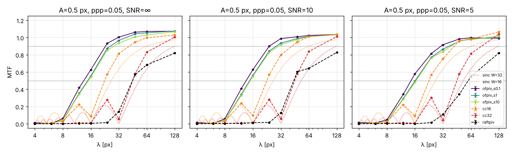
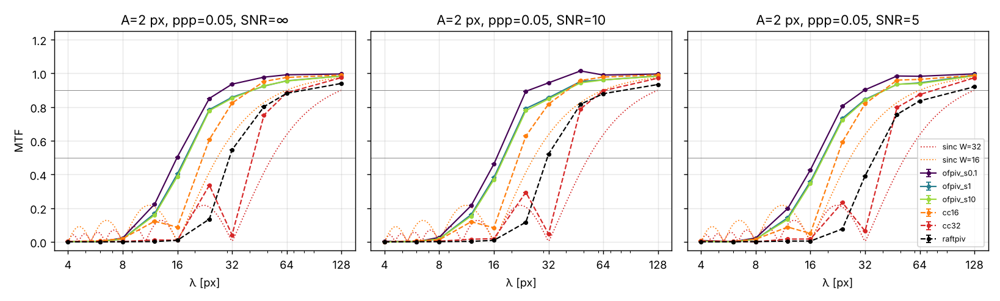
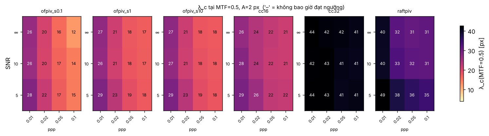
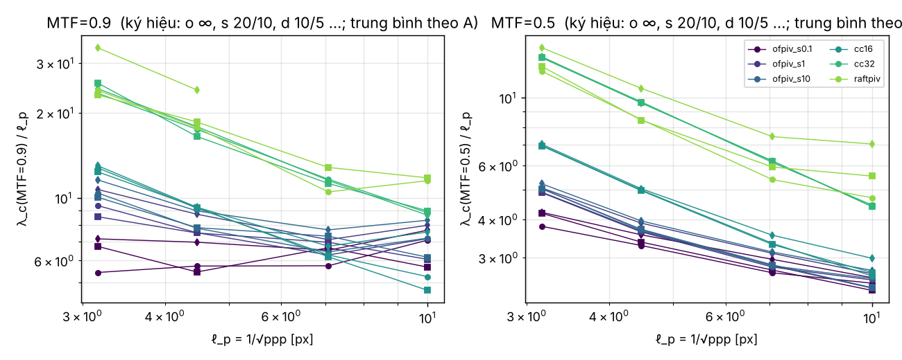
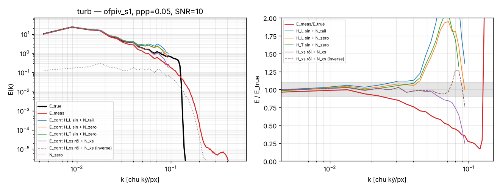
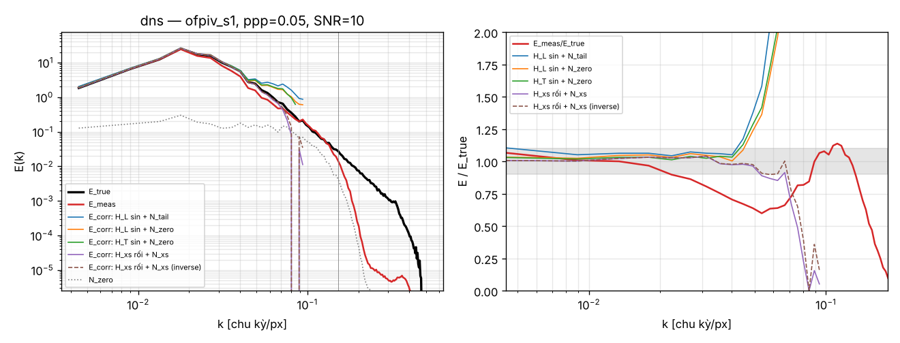
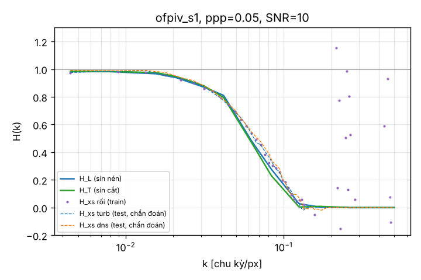

# P1 — Độ phân giải hiệu dụng và hiệu chỉnh phổ cho PIV dày đặc

Nhánh `p1-resolution-spectral-correction`. Mọi số liệu dưới đây đến từ ảnh hạt **tổng hợp** (bộ sinh `pivbench.synth`,
d_p = 2.5 px, ảnh 256×256, bỏ biên 16 px) chạy trên **CPU 4 nhân**, không có GPU.

> **Đánh dấu độ tin cậy**
> * 🟡 **[LƯỚI THU NHỎ]** — phần A: `scripts/mtf_sweep.py --quick` (240 cặp ảnh, 1 seed, A ∈ {0.5, 2}, ppp ∈ {0.01…0.1},
>   SNR ∈ {∞, 10, 5}, s ∈ {0.1, 1, 10}). Lưới đầy đủ theo đặc tả (1800 cặp × 8 cấu hình) **đang chạy/cần chạy lại**, xem §6.
> * 🟢 **[LƯỚI VỪA]** — phần B: 3 ppp × 3 SNR × 4 phương pháp, 16 trường huấn luyện + 16 trường kiểm tra mỗi ô,
>   H từ sin với 3 seed. Đủ để kết luận định tính, chưa đủ cho khoảng tin cậy chặt.
> * 🔴 **Không có DNS thật**: `data/` trống, và từ môi trường xây dựng không truy cập được pivchallenge.org lẫn JHTDB
>   (proxy chặn). Phần “DNS” dùng **DNS 2D tự giải** (`pivbench.resolution.dns2d`, Navier–Stokes giả phổ, rối 2D suy giảm,
>   phổ ~k⁻³, có xoáy kết hợp). Đây là rối 2D, không phải PIV Challenge 2005 Case B / JHTDB.

## 1. Phương pháp

### 1.1 Cấu hình phương pháp
| nhãn | mô tả |
|---|---|
| `ofpiv_s{s}` | OpenOpticalFlow_PIV (port Python), khởi tạo tương quan chéo, 1 lượt; λ_HS = 20·s, λ_LS = 2000·s. Lưới log 5 giá trị s ∈ {0.1, 0.316, 1, 3.16, 10} (quét **ghép cặp**; `--lambda-mode grid` cho tích 5×5) |
| `cc32`, `cc16` | tương quan chéo nhiều lượt, biến dạng cửa sổ đối xứng; cửa sổ 64→32 (1+2 lượt) và 64→32→16 (1+1+2 lượt), bước 25 % |
| `raftpiv` | RAFT-PIV **tái hiện** của repo (`checkpoints/raftpiv_wake_v2/best.pt`, huấn luyện cho wake đáy tù; không phải trọng số Lagemann et al.), 16 vòng lặp, CPU |

### 1.2 MTF (phần A)
Trường sin `u = A sin(2πx/λ)` (mode **dọc/nén**, đúng đặc tả), λ ∈ {4, 6, 8, 12, 16, 24, 32, 48, 64, 128} px. Khớp
`a sin θ + b cos θ + c` tại đúng λ ⇒ MTF = √(a²+b²)/A, lệch pha Δφ = atan2(b, a). λ_c(t) = λ nhỏ nhất mà từ đó trở lên
MTF ≥ t (nội suy log λ). Cùng một cặp ảnh cho mọi phương pháp. Đầu ra dạng tidy `results/p1_mtf_quick/mtf_long.csv`
(1 hàng / cấu hình × λ × A × ppp × SNR × seed), `cutoffs.csv`, `fits.csv`.

Mô hình λ_c: (i) luỹ thừa `λ_c = a·ppp^b·SNR^c·s^d` bằng hồi quy log (chỉ SNR hữu hạn); (ii) `λ_c = α·ℓ_p + β`,
ℓ_p = 1/√ppp (mọi SNR); (iii) tỉ số λ_c/ℓ_p. Lý thuyết top-hat cho CC: MTF = |sinc(W/λ)| ⇒ λ_c(0.5) = 1.66 W,
λ_c(0.9) = 3.99 W.

### 1.3 Hiệu chỉnh phổ (phần B)
Công thức đầy đủ: **[docs/P1_SPECTRAL_CORRECTION.md](../docs/P1_SPECTRAL_CORRECTION.md)**. Tóm tắt:

    E_meas(k) = |H(k)|² E_true(k) + N(k)
    E_corr(k) = max(E_meas − N, 0) · |H|² / (|H|⁴ + ε(1 − |H|²)²),   chỉ tại |H| > h_min   (ε = 0.01, h_min = 0.2)

(nghịch đảo thuần: E_corr = max(E_meas − N, 0)/|H|²). Số hạng ε(1 − |H|²)² triệt tiêu khi |H| = 1 nên H ≡ 1, N ≡ 0 trả về
đúng phổ gốc (có test). Biến thể so sánh:

| biến thể | H(k) | N(k) |
|---|---|---|
| `H_L sin + N_tail` | MTF sin **nén**, A = 1 px (= rms trường) | trung vị E_meas trên k ∈ [0.35, 0.5] |
| `H_L sin + N_zero` | như trên | phổ đầu ra trên cặp ảnh **dịch chuyển 0** (nhiễu ảnh độc lập) |
| `H_T sin + N_zero` | MTF sin **cắt** v = A sin(2πx/λ) (mode của trường div = 0) | N_zero |
| `H_xs rối + N_xs` | S_est,true/S_true,true trên 16 trường rối **huấn luyện** | E_meas − H²E_true trên tập huấn luyện |

Trường kiểm tra (seed khác tập huấn luyện): (a) rối 2D tổng hợp k^-5/3, pha ngẫu nhiên, div = 0, rms |u| = 1 px,
λ_min = 8 px; (b) DNS 2D (rms 1 px). Phổ 2D trung bình vòng, trung bình tập hợp 16 trường. Tiêu chí: **k₁₀** = số sóng lớn
nhất mà |E/E_true − 1| < 10 % liên tục từ k nhỏ (bỏ bin đầu), báo cáo λ₁₀ = 1/k₁₀. Bin phổ rộng Δk = 1/224, nên λ₁₀ chỉ
nhận các giá trị rời rạc 112, 56, 37.3, 28, 22.4, 18.7, 16 … px.

## 2. Kết quả phần A — bản đồ MTF 🟡 [LƯỚI THU NHỎ]




### 2.1 λ_c (MTF trung bình seed; px) tại ppp = 0.05
| cấu hình | A | λ_c(0.5) SNR ∞ / 10 / 5 | λ_c(0.9) SNR ∞ / 10 / 5 | lý thuyết sinc (0.5 / 0.9) |
|---|---|---|---|---|
| ofpiv_s0.1 | 0.5 | 13.4 / 13.5 / 14.5 | 23.0 / 24.0 / 30.5 | — |
| ofpiv_s1 | 0.5 | 14.8 / 14.8 / 16.1 | 26.0 / 28.6 / 37.2 | — |
| ofpiv_s10 | 0.5 | 15.1 / 15.0 / 16.5 | 28.3 / 30.3 / 39.2 | — |
| cc16 | 0.5 | 22.5 / 22.6 / 22.6 | 41.5 / 42.1 / 42.4 | 26.5 / 63.9 |
| cc32 | 0.5 | 45.1 / 45.1 / 45.2 | 84.3 / 81.8 / 83.3 | 53.0 / 127.8 |
| raftpiv | 0.5 | 44.9 / 44.0 / 59.9 | không đạt | — |
| ofpiv_s1 | 2 | 17.7 / 18.0 / 18.6 | 41.3 / 38.5 / 41.0 | — |
| cc16 | 2 | 22.1 / 21.8 / 22.4 | 40.7 / 40.6 / 40.3 | 26.5 / 63.9 |
| raftpiv | 2 | 31.0 / 31.5 / 36.1 | 79.2 / 82.9 / 107.7 | — |

Bảng đầy đủ (mọi ppp): `results/p1_mtf_quick/cutoffs_table.csv`; bản đồ nhiệt `figures/heatmap_lc{0.5,0.9}_A{0.5,2}.png`.



### 2.2 Mô hình λ_c (`fits.csv`)
| họ | A | t | mô hình luỹ thừa (SNR hữu hạn) | R² (log) | λ_c/ℓ_p (TB ± CV) |
|---|---|---|---|---|---|
| ofpiv (gộp s) | 0.5 | 0.5 | λ_c = 9.95·ppp^-0.236·SNR^-0.132·s^0.022 | 0.96 | 3.15 ± 25 % |
| ofpiv | 2 | 0.5 | λ_c = 11.3·ppp^-0.217·SNR^-0.078·s^0.020 | 0.93 | 3.71 ± 27 % |
| ofpiv | 0.5 | 0.9 | λ_c = 16.5·ppp^-0.385·SNR^-0.228·s^0.046 | 0.93 | 6.90 ± 20 % |
| ofpiv | 2 | 0.9 | λ_c = 17.8·ppp^-0.399·SNR^-0.233·s^0.057 | 0.90 | 8.14 ± 23 % |
| cc16 | 2 | 0.5 | λ_c = 18.2·ppp^-0.118·SNR^-0.068 | 0.92 | 4.49 ± 35 % |
| cc32 | 2 | 0.5 | λ_c = 39.2·ppp^-0.029·SNR^-0.016 | 0.85 | 8.11 ± 40 % |
| raftpiv | 2 | 0.5 | λ_c = 36.3·ppp^-0.120·SNR^-0.211 | 0.82 | 6.70 ± 36 % |



### 2.3 Nhận xét phần A
1. **Optical flow phân giải tốt nhất**: λ_c(0.5) ≈ 13–19 px ở ppp ≥ 0.05, so với 22 px (cc16), 45 px (cc32) và 31–60 px
   (RAFT-PIV tái hiện). Ở λ ≥ 64 px ofpiv có MTF ≈ 1.02–1.07 (vọt trên 1, đã biết từ bước dịch phần lẻ của bản gốc).
2. **λ_c của ofpiv không tỉ lệ với ℓ_p**: số mũ của ppp là −0.22 (MTF 0.5) và −0.39 (MTF 0.9), không phải −0.5. Tỉ số
   λ_c/ℓ_p dao động 25 %; λ_c(0.5) ≈ 3.2–3.7 ℓ_p chỉ là mô tả gần đúng. Mô hình luỹ thừa 3 biến giải thích 90–96 %
   phương sai log λ_c.
3. **Tham số điều chuẩn hầu như không ảnh hưởng**: tăng λ_HS, λ_LS 100 lần chỉ làm λ_c tăng 10–25 % (d ≈ 0.02–0.06).
   Với cấu hình 1 lượt, khởi tạo CC + 60 vòng Liu–Shen, độ phân giải bị chi phối bởi bộ lọc Gauss 6×6 tiền xử lý và lời giải
   khởi tạo, không phải bởi λ. Muốn đẩy λ_c xuống, cần thay đổi tiền xử lý/số vòng chứ không chỉ λ.
4. **CC tốt hơn sinc lý thuyết**: λ_c(0.5) đo bằng 0.83–0.85 lần 1.66 W (biến dạng cửa sổ lặp lại phục hồi một phần biên
   độ); λ_c(0.9) bằng 0.65 lần lý thuyết. Các thuỳ phụ của sinc (MTF ≈ 0.2–0.3 tại λ ≈ 0.7 W) xuất hiện đúng vị trí, và có
   đảo pha ở λ < W (cc32 tại λ = 24 px: lệch pha ≈ λ/2). λ_c của CC gần như không phụ thuộc ppp/SNR (b ≈ 0…−0.12).
5. **RAFT-PIV tái hiện** có MTF mode nén rất thấp ở A = 0.5 (không đạt 0.9 tới λ = 128 px). Đây là prior “không nén được”
   do dữ liệu huấn luyện (đã ghi trong `docs/RAFTPIV_WAKE.md`). Với A = 2 thì khá hơn. Nhạy SNR nhất (c ≈ −0.2…−0.37).
6. Biên độ A có tác dụng phi tuyến: với ofpiv, A = 2 làm λ_c(0.9) tăng từ 26 lên 41 px. **Không có một “MTF” duy nhất**
   cho mỗi phương pháp.

## 3. Kết quả phần B — hiệu chỉnh phổ 🟢 [LƯỚI VỪA]

### 3.1 λ₁₀ [px] (nhỏ hơn = tốt hơn), trung bình trên ppp ∈ {0.02, 0.05, 0.1}
| trường | phương pháp | SNR | đo (không hiệu chỉnh) | H_L sin + N_tail | H_L sin + N_zero | H_T sin + N_zero | **H_xs + N_xs** (Wiener) | H_xs + N_xs (nghịch đảo) |
|---|---|---|---|---|---|---|---|---|
| rối k^-5/3 | ofpiv_s1 | ∞ | 48.5 | 53.1 | 53.1 | 42.5 | **16.9** | 13.9 |
| | | 10 | 52.3 | 57.2 | 30.7 | 31.5 | **23.2** | 20.8 |
| | | 5 | 39.8 | 68.4 | 35.5 | 42.5 | **18.2** | 16.8 |
| | cc16 | ∞ | 56.0 | 33.1 | 33.1 | 38.0 | **25.1** | 18.7 |
| | | 10 | 56.0 | 36.3 | 34.9 | 38.0 | **24.1** | 23.1 |
| | cc32 | 10 | 112 | 87.1 | 77.2 | 112 | **44.8** | 39.8 |
| | raftpiv | 10 | 44.8 | — | — | 66.7 | **41.9** | 42.9 |
| DNS 2D | ofpiv_s1 | ∞ | 58.5 | 30.7 | 30.7 | 30.7 | **19.0** | 17.4 |
| | | 10 | 58.5 | 34.4 | 29.9 | 34.4 | **26.7** | 26.1 |
| | cc16 | 10 | 56.0 | 32.0 | 32.0 | 36.3 | **27.0** | 28.0 |
| | cc32 | 10 | 112 | **44.8** | **44.8** | 65.3 | 78.4 | 84.0 |
| | raftpiv | 10 | 35.6 | — | — | 56.0 | 52.3 | 52.3 |

(“—” = hỏng ngay từ bin thứ 2: H_L của RAFT-PIV < ngưỡng hoặc sai hoàn toàn.) Bảng đầy đủ: `results/p1_spectral/k10.csv`.

**Tỉ lệ cải thiện k₁₀(E_corr)/k₁₀(E_meas)**, trung vị trên mọi phương pháp/ppp/SNR:

| trường | H_L+N_tail | H_L+N_zero | H_T+N_zero | H_xs+N_xs Wiener | H_xs+N_xs nghịch đảo |
|---|---|---|---|---|---|
| rối k^-5/3 (cùng loại với huấn luyện) | ×1.00 | ×1.29 | ×1.23 | **×2.25** | **×2.63** |
| DNS 2D (khác loại) | ×1.75 | ×1.75 | ×1.45 | ×1.25 | ×1.25 |

Sai lệch log trung bình |log(E/E_true)| trên dải hiệu chỉnh (trung vị): rối 2.04 → 0.21 (H_xs Wiener) / 0.07 (H_xs nghịch đảo);
DNS 1.25 → 0.15 (H_xs) / 0.35–0.41 (sin).




### 3.2 Kiểm tra chéo (mục 9): H(k) từ sin có dùng được cho trường rối không?


Sai lệch lớn nhất |H_sin − H_xs,test| trên vùng H > 0.2 (trung vị trên ppp × SNR):

| phương pháp | H_L vs rối | H_T vs rối | H_T vs DNS | H_xs(rối, train) vs DNS | N_xs / N_zero (k = 0.03–0.09) |
|---|---|---|---|---|---|
| ofpiv_s1 | 0.07 | 0.11 | 0.13 | 0.05 | ×2.8 (SNR 10), ×1.6 (SNR 5), N_zero ≡ 0 khi SNR ∞ |
| cc16 | 0.04 | 0.11 | 0.14 | 0.05 | ×5–9 |
| cc32 | 0.06 | 0.10 | 0.09 | 0.08 | ×8–39 |
| raftpiv | **0.44** | 0.08 | 0.20 | 0.18 | ×30–130 |

Kết luận:
1. **Về biên độ, H(k) đo trên sin chuyển sang trường rối khá tốt** đối với ofpiv và CC (sai lệch ≤ 0.1). Với các phương pháp
   này, tính phi tuyến hầu như không làm méo H, nếu biên độ sin được chọn bằng rms của trường.
   **Ngoại lệ là RAFT-PIV**: H_L (mode nén) sai 0.44, chỉ H_T (mode cắt, đúng loại mode của trường div = 0) mới dùng được.
   Vì vậy **phải đo H bằng mode cắt khi trường không nén**.
2. **Chỗ hỏng thật sự là sàn nhiễu.** Sai số trong trường rối (do gradient, hạt mất cặp, điều chuẩn) lớn gấp 2–100 lần
   sai số trên cặp ảnh dịch chuyển 0. Với SNR = ∞, N_zero = 0 trong khi sai số thật vẫn khác 0. N_tail đo ở k > 0.35 nên
   không đại diện cho vùng k = 0.03–0.1, nơi bộ lọc của phương pháp còn cho sai số đi qua. Hệ quả là hiệu chỉnh dựa trên
   sin + N_zero/N_tail **khuếch đại phần sai số còn sót**: E_corr vọt lên 1.5–3× E_true ngay khi |H| < 0.6
   (hình phải ở trên). Vì thế λ₁₀ của các biến thể này chỉ tốt hơn đo 1.2–1.75 lần, có ô còn kém hơn (ofpiv, rối, N_tail).
3. **Đo trực tiếp H_xs và N_xs bằng phổ chéo trên tập rối tổng hợp** cho kết quả tốt nhất trên trường cùng loại:
   λ₁₀ giảm từ ~50 xuống 17–25 px (ofpiv, cc16), tức cải thiện ×2.2–2.6. Khi chuyển sang DNS 2D (khác thống kê và
   cấu trúc xoáy), H_xs vẫn khớp (sai lệch 0.05) nhưng N_xs thì không: cải thiện chỉ còn ×1.25. Riêng cc32 trên DNS,
   hiệu chỉnh H_xs còn **kém hơn** hiệu chỉnh từ sin. Với RAFT-PIV trên DNS, mọi hiệu chỉnh đều làm λ₁₀ **xấu đi** (35.6 → 52 px). **Hiệu chỉnh phổ chỉ đáng tin khi sàn nhiễu được hiệu chuẩn trên
   trường có thống kê gần với trường đo** (cùng rms, cùng độ dốc phổ/gradient).
4. Wiener so với nghịch đảo: khi dùng H_xs + N_xs đúng, nghịch đảo cho sai lệch log nhỏ hơn (0.07 so với 0.21) vì
   Wiener có thiên lệch thấp có hệ thống ở vùng |H| ≈ 0.2–0.5. Khi N bị đánh giá thấp, Wiener an toàn hơn.
   Nên giữ Wiener làm mặc định khi N không chắc chắn.

## 4. Hạn chế
* Phần A mới chạy trên **lưới thu nhỏ**: 1 seed, 2 biên độ, 3 giá trị s, thiếu ppp 0.005, SNR 20. Chưa có thanh sai số
  theo seed. Lưới đầy đủ: §6.
* Ảnh 256×256: với λ = 128 px chỉ có 1.75 chu kỳ trên vùng khớp (sai số pha lớn). Phổ có độ phân giải Δk = 1/224, nên
  λ₁₀ bị lượng tử hoá (56 → 37 → 28 → 22 px). Muốn so sánh mịn hơn cần ảnh 512² hoặc 1024².
* **Không có DNS thật** (PIV Challenge 2005 Case B / JHTDB). DNS 2D tự giải chỉ là thay thế, có phổ dốc ~k⁻³.
* RAFT-PIV là bản **tái hiện** huấn luyện cho wake, không phải bản chính thức. Kết quả của nó không đại diện cho RAFT-PIV gốc.
* ofpiv chỉ ở cấu hình 1 lượt có khởi tạo CC. Chưa thử `shift_method='warp'` hay nhiều lượt (đã biết là đổi MTF ở λ lớn).
* Mô hình hiệu chỉnh là tuyến tính–dịch bất biến. N(k) phụ thuộc trường, nên hiệu chỉnh không có giá trị ngoài miền
  thống kê của tập hiệu chuẩn.
* Giao diện MATLAB `matlab/p1/p1_resolution_gui.m` **chưa được chạy trong MATLAB thật**: không có MATLAB trong môi trường.
  Các hàm tính toán thuần (`p1_*.m`) đã được test trên GNU Octave 8.4. File GUI phân tích cú pháp được trong Octave.

## 5. Tái lập
```bash
pip install -e ".[all]"
pytest tests/test_resolution.py                    # 17 test (MTF, H, hiệu chỉnh: H=1 ⇒ phổ gốc)
python scripts/mtf_sweep.py --quick                 # phần A, ~10 phút CPU 4 nhân → results/p1_mtf_quick
python scripts/spectral_correction.py --out results/p1_spectral --ppp 0.02 0.05 0.1 --snr inf 10 5 \
    --n-train 16 --n-test 16 --n-zero 4 --seeds-sine 3   # phần B, ~35 phút
```
MATLAB: `cd matlab/p1; p1_resolution_gui` (xem `matlab/p1/README_P1_MATLAB.md`); test `cd tests; test_p1_matlab`.

## 6. Thí nghiệm cần chạy trên GPU / máy nhiều nhân
`ofpiv` và `crosscorr` là numpy, chạy trên CPU; ước lượng thời gian dưới đây cho 32 nhân. Chỉ `raftpiv` dùng GPU
(thêm `device='cuda'`: sửa `method_configs` trong `scripts/mtf_sweep.py` hoặc đặt `CUDA_VISIBLE_DEVICES`).

1. **Lưới MTF đầy đủ theo đặc tả** (10 λ × 3 A × 5 ppp × 4 SNR × 3 seed = 1800 cặp × 8 cấu hình; ~2 giờ trên 4 nhân,
   ~15 phút trên 32 nhân):
   ```bash
   python scripts/mtf_sweep.py --out results/p1_mtf_full --workers 32
   ```
2. **Lưới λ đầy đủ 5×5 (λ_HS × λ_LS)** cho ofpiv:
   ```bash
   python scripts/mtf_sweep.py --out results/p1_mtf_lambda_grid --methods ofpiv --lambda-mode grid --workers 32
   ```
3. **MTF mode cắt** (cần cho trường không nén, đặc biệt với RAFT-PIV):
   ```bash
   python scripts/mtf_sweep.py --component v --out results/p1_mtf_full_transverse --workers 32
   ```
4. **Ảnh lớn 512²** (λ = 128 có ≥ 3.5 chu kỳ, phổ mịn gấp đôi):
   ```bash
   python scripts/mtf_sweep.py --shape 512 512 --border 32 --out results/p1_mtf_512 --workers 32
   python scripts/spectral_correction.py --shape 512 512 --border 32 --turb-kmax 64 --out results/p1_spectral_512 \
       --ppp 0.02 0.05 0.1 --snr inf 10 5 --n-train 32 --n-test 32 --seeds-sine 3 --workers 32
   ```
5. **Kịch bản gradient mạnh** (rms 2 px, năng lượng tới λ = 4 px; trên CPU thấy mọi phương pháp suy giảm từ λ ≈ 45 px):
   ```bash
   python scripts/spectral_correction.py --rms 2 --turb-kmax 64 --out results/p1_spectral_strong --workers 32
   ```
6. **DNS thật**: đặt PIV Challenge 2005 Case B (`data/raw/pivc2005_caseB/truth.npz`) hoặc lát JHTDB
   (`data/raw/jhtdb_slice.h5`, khoá u, v theo px/Δt). Script tự phát hiện, hoặc truyền thẳng:
   ```bash
   python scripts/spectral_correction.py --dns-path data/raw/jhtdb_slice.h5 --out results/p1_spectral_jhtdb --workers 32
   ```
7. RAFT-PIV **chính thức** nếu có trọng số (`third_party/RAFT-PIV`, `RAFTPIV_CKPT`): thêm cấu hình `backend='official'`
   vào `method_configs` rồi chạy lại 1 và 3 trên GPU.
